<picture><source media="(prefers-color-scheme: dark)" srcset="assets/header-dark.svg"></picture>

Fullstack engineer. I build web systems, data pipelines and offline-first apps that have to run every day, on thin margins and patchy connections. I'm based in Mindelo, Cabo Verde, and work remotely.

> **Open to remote roles and freelance projects.** [Tell me what you're building →](https://birewa.com/en#contact)

 

<picture><source media="(prefers-color-scheme: dark)" srcset="assets/h-skills-dark.svg"></picture>

Every skill below is measured, not self-rated: each thread is as long as the number of my shipped projects that use it, and each technology is listed because it appears in those projects' real stacks.

<picture><source media="(prefers-color-scheme: dark)" srcset="assets/loom-dark.svg"></picture>

<b>Technologies behind each skill</b>

<!-- skills:start (generated by scripts/build.php, do not edit by hand) -->

**Core** · used in 10+ projects

<picture><source media="(prefers-color-scheme: dark)" srcset="assets/skill-front-dark.svg"></picture> **[Front-end JS / TS](https://birewa.com/en/skills/front-end-vue-react-typescript)** · 14 projects 
`JavaScript` `Vite` `TypeScript` `Vue` `jQuery` `React`

<picture><source media="(prefers-color-scheme: dark)" srcset="assets/skill-ui-dark.svg"></picture> **[Interface & design](https://birewa.com/en/skills/ui-integration-tailwind)** · 12 projects 
`Tailwind CSS` `Bootstrap` `HTML / CSS` `GSAP` `Nuxt UI`

<picture><source media="(prefers-color-scheme: dark)" srcset="assets/skill-data-dark.svg"></picture> **[Databases](https://birewa.com/en/skills/databases-mysql-postgresql)** · 11 projects 
`MySQL` `PostgreSQL` `Supabase` `SQLite` `Prisma`

<picture><source media="(prefers-color-scheme: dark)" srcset="assets/skill-back-dark.svg"></picture> **[Back-end Laravel / Node](https://birewa.com/en/skills/back-end-laravel-node)** · 10 projects 
`Laravel` `PHP` `Blade` `Node.js`

**Solid** · used in 5 to 9 projects

<picture><source media="(prefers-color-scheme: dark)" srcset="assets/skill-secu-dark.svg"></picture> **[Security & access](https://birewa.com/en/skills/security-access-control)** · 7 projects 
`Spatie Permission` `Web Crypto` `Laravel Sanctum` `Google reCAPTCHA` `Firebase Auth`

<picture><source media="(prefers-color-scheme: dark)" srcset="assets/skill-devops-dark.svg"></picture> **[Deployment & CI](https://birewa.com/en/skills/deployment-docker-ci-cd)** · 7 projects 
`GitHub Actions` `Vercel` `Docker` `Shared hosting` `Apache` `Nginx`

<picture><source media="(prefers-color-scheme: dark)" srcset="assets/skill-tests-dark.svg"></picture> **[Testing & quality](https://birewa.com/en/skills/testing-quality)** · 6 projects 
`PHPUnit` `Vitest` `Playwright` `ESLint` `Prettier` `Zod`

<picture><source media="(prefers-color-scheme: dark)" srcset="assets/skill-docs-dark.svg"></picture> **[Documents & reporting](https://birewa.com/en/skills/documents-pdf-reporting)** · 5 projects 
`DomPDF` `ApexCharts` `VBA` `DataTables` `TCPDF`

**Growing** · used in a few projects

<picture><source media="(prefers-color-scheme: dark)" srcset="assets/skill-tools-dark.svg"></picture> **[Tooling & AI](https://birewa.com/en/skills/developer-tooling-ai)** · 4 projects 
`Git` `PostHog` `Claude Code plugins` `GitHub CLI` `git worktrees` `Gemini API`

<picture><source media="(prefers-color-scheme: dark)" srcset="assets/skill-auto-dark.svg"></picture> **[Data & automation](https://birewa.com/en/skills/data-automation-python)** · 3 projects 
`Scheduled jobs` `Python` `DredgeView formats` `CSV` `Queues` `Echo + Pusher`

<picture><source media="(prefers-color-scheme: dark)" srcset="assets/skill-offline-dark.svg"></picture> **[Offline-first & PWA](https://birewa.com/en/skills/offline-first-pwa)** · 2 projects 
`Workbox` `Dexie / IndexedDB`

<!-- skills:end -->

The projects behind these numbers are on [birewa.com/work](https://birewa.com/en/work). Each skill has its own page there, listing the projects that use it.

 

<picture><source media="(prefers-color-scheme: dark)" srcset="assets/h-now-dark.svg"></picture>

- **[issue-to-pr-runner](https://agensi.io/skills/issue-to-pr-runner)**: a Claude Code plugin that turns a prompt into a reviewed pull request, one checkable artefact at a time.
- **[wascal-cape-coast-2026](https://github.com/Dreykovic/wascal-cape-coast-2026)**: the open-source logbook of a 32-student WASCAL cohort ([live](https://wascal.birewa.com)). Laravel 13, no front-end build.
- **Research**: Master's in Marine Sciences & Climate Change (WASCAL), the domain behind my geospatial and environmental data work.
- **Reviewing**: external evaluator for MIT Solve.

 

<picture><source media="(prefers-color-scheme: dark)" srcset="assets/h-contact-dark.svg"></picture>

<a href="https://birewa.com"><picture><source media="(prefers-color-scheme: dark)" srcset="assets/btn-site-dark.svg"></picture></a>
<a href="https://www.linkedin.com/in/audrey-amona/"><picture><source media="(prefers-color-scheme: dark)" srcset="assets/btn-linkedin-dark.svg"></picture></a>
<a href="mailto:dreybirewa@gmail.com"><picture><source media="(prefers-color-scheme: dark)" srcset="assets/btn-email-dark.svg"></picture></a>

dreybirewa@gmail.com · Mindelo, Cabo Verde (UTC−1) · [Lire en français](https://birewa.com/fr)

 

<picture><source media="(prefers-color-scheme: dark)" srcset="assets/kente-dark.svg"></picture>
