<picture><source media="(prefers-color-scheme: dark)" srcset="assets/header-dark.svg"></picture>

I build **production-ready web products**: clean architecture, reliable backends, and apps that keep working when the connection doesn't. I'm based in Mindelo, Cabo Verde, and work remotely with teams and clients across West Africa and beyond.

My work has covered maritime survey data for a Dutch dredging multinational, HR and pharmacy systems in daily production use, fintech and food-tech platforms, and AI consulting. These projects have thin margins, patchy connectivity, and processes that have to run every day. So I build offline-first, cheap to run, and honest about failure.

- **Also:** external evaluator for MIT Solve · Master's researcher in Marine Sciences & Climate Change (WASCAL)
- **Stack:** TypeScript · Node.js · React · Next.js · Vue · Laravel · PostgreSQL

> **Open to remote roles and freelance projects.** [Tell me what you're building →](https://birewa.com/en#contact)

 

<picture><source media="(prefers-color-scheme: dark)" srcset="assets/h-work-dark.svg"></picture>

<picture><source media="(prefers-color-scheme: dark)" srcset="assets/sig-epi-fiche-generator-dark.svg"></picture>

**[Coastal Survey Automation](https://birewa.com/en/work/coastal-survey)** · DATA TOOL · 2025 
Turns raw hydrographic survey data into the as-built control sheets that check that each coastal groyne is built to its design. 
`Python` `VBA / Excel` `DredgeView survey formats` `CSV`

<picture><source media="(prefers-color-scheme: dark)" srcset="assets/sig-optirh-dark.svg"></picture>

**[OptiRH](https://birewa.com/en/work/optirh)** · PLATFORM · IN PRODUCTION 
The internal HR platform of ARCOP, Togo's public procurement regulator: staff records, leave and absence requests with their approvals, and HR document requests, all on software instead of paper. 
`Laravel` `PHP` `MySQL` `Bootstrap` `DataTables`

<picture><source media="(prefers-color-scheme: dark)" srcset="assets/sig-pharmacy-sys-dark.svg"></picture>

**[PharmaSys](https://birewa.com/en/work/pharmasys)** · PLATFORM · 2026 
Management software for the pharmacy of a medical-social centre in Togo: sales, batch stock, insurance claims, medical acts, purchasing, staff and accounting in one tool. 
`Laravel` `PostgreSQL` `Tailwind CSS` `DomPDF`

<picture><source media="(prefers-color-scheme: dark)" srcset="assets/sig-tchona-dark.svg"></picture>

**[Tchona](https://birewa.com/en/work/tchona)** · OFFLINE-FIRST APP · 2026 · [live ↗](https://tchona.vercel.app) 
A phone app that shows a small trader their real turnover, margins and month-end forecast from the prices and sales they enter, and works with no internet. 
`Vue 3` `TypeScript` `Dexie / IndexedDB` `Tailwind CSS`

Client code lives in private repositories. I'm happy to walk you through it on request. [All 16 projects →](https://birewa.com/en/work)

 

<picture><source media="(prefers-color-scheme: dark)" srcset="assets/h-open-dark.svg"></picture>

<picture><source media="(prefers-color-scheme: dark)" srcset="assets/sig-issue-runner-dark.svg"></picture>

**[issue-to-pr-runner](https://agensi.io/skills/issue-to-pr-runner)** · DEVELOPER TOOL · 2026 
A Claude Code plugin that turns a prompt into a reviewed pull request, one checkable artefact at a time. 
`Node.js` `Claude Code plugins` `GitHub CLI` `git worktrees`

<picture><source media="(prefers-color-scheme: dark)" srcset="assets/sig-cape-coast-logbook-dark.svg"></picture>

**[wascal-cape-coast-2026](https://github.com/Dreykovic/wascal-cape-coast-2026)** · WEB APP · 2026 · [live ↗](https://wascal.birewa.com) 
A one-page site and a small self-service admin that turn a 16-week study programme abroad into a shared logbook for a 32-student West African cohort. No front-end build, and it deploys on shared hosting. 
`Laravel 13` `MySQL / SQLite` `Vanilla JS`

 

<picture><source media="(prefers-color-scheme: dark)" srcset="assets/h-weave-dark.svg"></picture>

Every project is a row and every skill family a coloured thread, worked out from each project's real stack. Nothing is hand-picked.

<b>Show the weave</b>: 16 projects × 11 skill threads

 
<a href="https://birewa.com/en"><picture><source media="(prefers-color-scheme: dark)" srcset="assets/weave-dark.svg"></picture></a>

 

<picture><source media="(prefers-color-scheme: dark)" srcset="assets/h-contact-dark.svg"></picture>

A web app, a platform, an internal tool, or an app that has to work offline: let's talk about what needs to run every day.

<a href="https://birewa.com"><picture><source media="(prefers-color-scheme: dark)" srcset="assets/btn-site-dark.svg"></picture></a>
<a href="https://www.linkedin.com/in/audrey-amona/"><picture><source media="(prefers-color-scheme: dark)" srcset="assets/btn-linkedin-dark.svg"></picture></a>
<a href="mailto:dreybirewa@gmail.com"><picture><source media="(prefers-color-scheme: dark)" srcset="assets/btn-email-dark.svg"></picture></a>

dreybirewa@gmail.com · Mindelo, Cabo Verde (UTC−1) · [Lire en français](https://birewa.com/fr)

 

<picture><source media="(prefers-color-scheme: dark)" srcset="assets/kente-dark.svg"></picture>
