<picture><source media="(prefers-color-scheme: dark)" srcset="assets/header-dark.svg"></picture>

 

<picture><source media="(prefers-color-scheme: dark)" srcset="assets/h-work-dark.svg"></picture>

<a href="https://birewa.com/en/work/coastal-survey"><picture><source media="(prefers-color-scheme: dark)" srcset="assets/card-epi-fiche-generator-dark.svg"></picture></a>
<a href="https://birewa.com/en/work/optirh"><picture><source media="(prefers-color-scheme: dark)" srcset="assets/card-optirh-dark.svg"></picture></a>
<a href="https://birewa.com/en/work/pharmasys"><picture><source media="(prefers-color-scheme: dark)" srcset="assets/card-pharmacy-sys-dark.svg"></picture></a>
<a href="https://birewa.com/en/work/tchona"><picture><source media="(prefers-color-scheme: dark)" srcset="assets/card-tchona-dark.svg"></picture></a>

 

<picture><source media="(prefers-color-scheme: dark)" srcset="assets/h-weave-dark.svg"></picture>

<a href="https://birewa.com/en"><picture><source media="(prefers-color-scheme: dark)" srcset="assets/weave-dark.svg"></picture></a>

 

<picture><source media="(prefers-color-scheme: dark)" srcset="assets/h-contact-dark.svg"></picture>

<a href="https://birewa.com"><picture><source media="(prefers-color-scheme: dark)" srcset="assets/btn-site-dark.svg"></picture></a>
<a href="https://www.linkedin.com/in/audrey-amona/"><picture><source media="(prefers-color-scheme: dark)" srcset="assets/btn-linkedin-dark.svg"></picture></a>
<a href="mailto:dreybirewa@gmail.com"><picture><source media="(prefers-color-scheme: dark)" srcset="assets/btn-email-dark.svg"></picture></a>

 

<picture><source media="(prefers-color-scheme: dark)" srcset="assets/kente-dark.svg"></picture>
